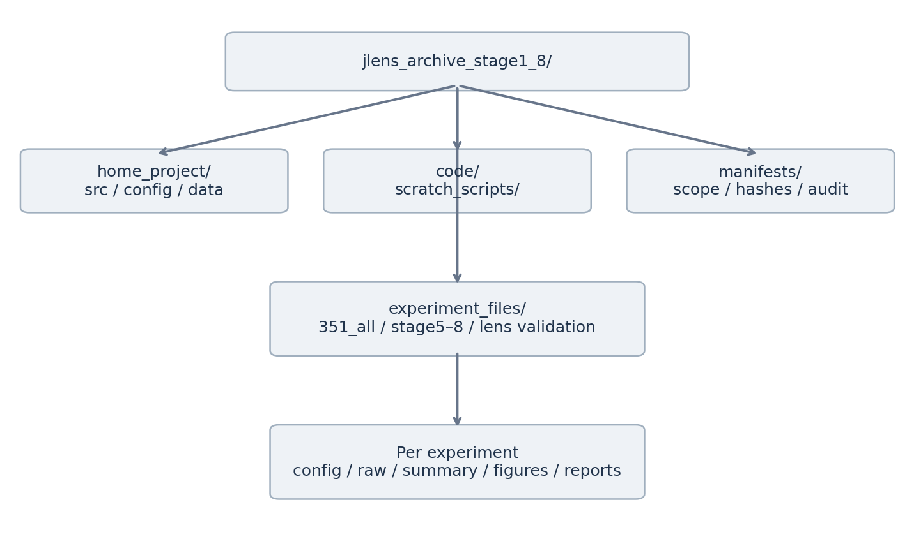

# READ ME FIRST — How Do Titles Support Author Prediction?

## One-Page Summary

**Question: Can a paper's title raise the readout score of the correct author?**

- Model: Qwen3-32B. We compare J-Lens, Vanilla, and Final-model outputs.
- Readout: Look at the Gold Token rank first, then separate the first token of a name from the continuation after the correct prefix.
- Controls: Hold the author candidates fixed and compare the true title against matched wrong titles; finally, validate on new papers.

**Strongest result: On the 200 new Stage 8 papers, the mean Title Advantage at L56 is +5.18 percentage points; the mean A−B difference is +4.98 percentage points, but it is sensitive to a small number of strongly positive pairs.**

This does not support claims of full author-identity recovery, causal Recall, or J-Lens outperforming Vanilla. For completeness and exclusions, see [ARCHIVE_NOTES.md](ARCHIVE_NOTES.md). This file references images in `docs/assets/`; the two must be kept together in the archive root.

## Start Here

| Your task | Reading path |
|---|---|
| Understand the study | Summary → Concepts → Research thread → Stage 8 results |
| Check the evidence | Stage cards → corresponding Report/CSV → Config/Raw |
| Take over the runs | Directory map → CPU exercise → ARCHIVE_NOTES and the actual CLI |

## Concepts at a Glance

- **J-Lens (Jacobian Lens)**: This project uses a Jacobian mapping estimated from generic text to read the internal representation at a given source layer toward the target-layer representation space, then applies the output readout to obtain vocabulary scores. The input is the model's intermediate representation; the output is Token scores/ranks, not a label for "whether the knowledge exists." The exact normalization and mapping operation are defined by the implementation and configuration used in this package.
- **Vanilla**: No Jacobian mapping; the intermediate representation is converted to Token scores directly through the baseline readout path.
- **Layers**: L16/24/32/40/48/56/62 are the source layers; L63 is the Final layer, listed separately as the Reference, and the seven-layer Integrated score does not include it.
- **Gold / False**: The true author candidate / a wrong author candidate. In the later stages the comparison is mainly on the first token of the first author.
- **Wrong-title / Shuffled**: Pre-selected, metadata-matched replacement titles (the "Shuffled" in the reports is this kind of control) [TO VERIFY: the statement "not a word-level shuffle"]; not a naturally exchangeable randomization sample.
- **Recognition**: The behavioral result of identifying the author team from the options. **R0** means m=0, no matched author; **R1** means m>0, a partial match.

| Behavior group | Recognition | Recall | Current cohort N |
|---|---|---|---:|
| A | Pass | R0 | 4110 |
| B | Fail | R0 | 2186 |
| C | Pass | R1 | 511 |
| D | Fail | R1 | 34 |

**Shared settings:** Qwen3-32B BF16; model revision `9216db5781bf21249d130ec9da846c4624c16137`; source layers L16/24/32/40/48/56/62. For specific parameters, use each Stage's frozen config.

**Samples:** 6,841 papers in total; the source labels cover 9,108 papers. Pilot50 = A20/B20/C7/D3 (20 A/B pairs); Stage 8 = 200 new papers (Pilot50 excluded), 100 A/B pairs, with Low/Middle/High being 25/50/25 pairs. HR2 follows the definition in the label package and must not be interpreted by yourself as author Recall Accuracy. The current work did not create a new Build/Tune/Test split; the earlier matched splits belong to the historical plan.

**Three different A/B labelings — do not mix them: behavior A/B is the Recognition grouping; historical Lens A/B is the 50/50 fitting texts; Stage 9 Fit A/B is the new 100/100 fitting texts.**

| Metric | How it is computed / what it measures |
|---|---|
| RR | 1 / the Gold Token's rank in the full vocabulary |
| Full-name JMRR | Average over tokens within an author, then over authors within a paper; later tokens are given the correct prefix |
| Gold Win Rate | Gold first token beats a False record = 1, tie = .5, loss = 0, then averaged |
| Title Advantage | True-title Win Rate − mean of the 20 Wrong-title Win Rates |
| A−B | Effect difference within a matched paper pair |
| J−V | J-Lens effect minus Vanilla effect on the same paper under the same conditions |

## Research Thread

**Where does the score come from?** Stage 4 → Stage 6 → Stage 7.1.  
**Does it depend on the correct title?** Stage 5 → Stage 7.2 → Stage 7.3.  
**Is it consistent, and does it generalize?** Stage 7.4 → Stage 8.  
Fidelity, provenance audit, and the historical Split-half run through all three lines.

### Stage 4 · Is the mean pulled up by a few papers?
- Approach: Benchmark20; examine the distribution across papers and each paper's contribution.
- Key numbers: L56 first-listed first-token RR mean .007040 (median .000920); a single paper contributes 71.03%.
- Judgment: The mean alone does not show broad accessibility; move on to author coverage and name position.

### Stage 5 · Does the score depend on the title–author correspondence?
- Approach: Two titles × two authors, crossed; Q's author and Q's title must come from the same source.
- Key numbers: L56 pooled logit contrast +1.16679; the Integrated A−B interval crosses zero.
- Judgment: Title sensitivity exists, but a single False/Title reference is still too narrow.

### Stage 6 → 7.1 · Does the advantage arise before the name starts, or after a prefix is given?
- Approach: 50 papers, 227 paper-author instances; reuse the per-token scores and split them into First / Continuation.
- Key numbers: A−B: First +.00137 (CI crosses zero); Continuation +.02064 (nominal CI is positive). [TO VERIFY: the archived report does not state the layer or aggregation; check whether this is Integrated]
- Judgment: The difference is concentrated in conditional continuation; the role of the prefix is not causally isolated.

### Stage 7.2 → 7.3 · Does the Gold advantage remain after subtracting the wrong-title background?
- Approach: 100 False names per paper; fixed candidates, plus 20 Wrong titles per paper.
- Key numbers: the 100 names average 45.76 distinct first tokens; Pilot50 L56 Title Advantage +.093435.
- Judgment: The pooled title effect is retained, while the Integrated A−B remains uncertain; a candidate's first token is not a full identity.

### Stage 7.4 · Are the methods consistent, and does J-Lens provide additional information?
- Approach: Cross-stage correlation on the same 50 papers, and a same-paper J−V comparison.
- Key numbers: L56 Pearson .445; Integrated J−V +.00221, CI crosses zero.
- Judgment: Moderate measurement consistency; independent replication and a J-Lens increment are not established.

### Stage 8 · Does the signal hold on new papers?
- Approach: Exclude Pilot50; freeze 200 papers / 100 pairs, the candidates, and the titles; L56 is the pre-specified primary layer.
- Key numbers: RQ1 +5.18 pp; RQ2 +4.98 pp.
- Judgment: The new targets retain the mean title effect; read the group difference together with the influence analysis.

## Directory Map: Where to Find the Evidence

For completeness and exclusions, see [ARCHIVE_NOTES.md](ARCHIVE_NOTES.md). In the table below, all outputs are relative to `experiment_files/` and source code is relative to `code/scratch_scripts/`.

| Content | Source code | Output entry point |
|---|---|---|
| Cohort | 351_prepare_all.py | 351_all/; labels_20261015/ |
| Stage 4 | 351_stage4_readout.py; 351_stage4_audit.py | 351_all/351_stage4_artifacts/ |
| Stage 5 | 351_stage5.py | 351_stage5_crossed_v2/ |
| Stage 6 | 351_stage6.py | 351_stage6/ |
| Stage 7.1 | 351_stage7.py | 351_stage7_1/ |
| Stage 7.2/7.3 | 351_stage7_2.py / 351_stage7_3.py and the respective _score.py | 351_stage7_2/; 351_stage7_3/ |
| Stage 7.4 | 351_stage7_4.py | 351_stage7_4/ |
| Stage 8A–D | 351_stage8.py, 351_stage8B/C/D.py | 351_stage8/; 8D is under its stage8D/ |

Read each experiment in the order **config → cohort/matching/controls → raw → summary → figures/reports**; not every stage contains all of these subdirectories.

## Status

| Status | Content |
|---|---|
| Executed, outputs exist, archived | Stage 4–8D; cohort, historical fitting/validation, and Split-half materials |
| Execution identity must be verified run by run | Whether the currently collected source matches the historical executed version character for character; some historical environments/parameters |
| Not executed | Stage 8E; draft numbers are not treated as verified evidence |
| Excluded from this package, archived separately | Stage 7.1B, Stage 9 (still running at archive time) |
