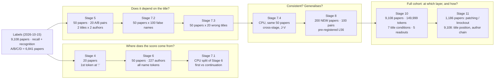
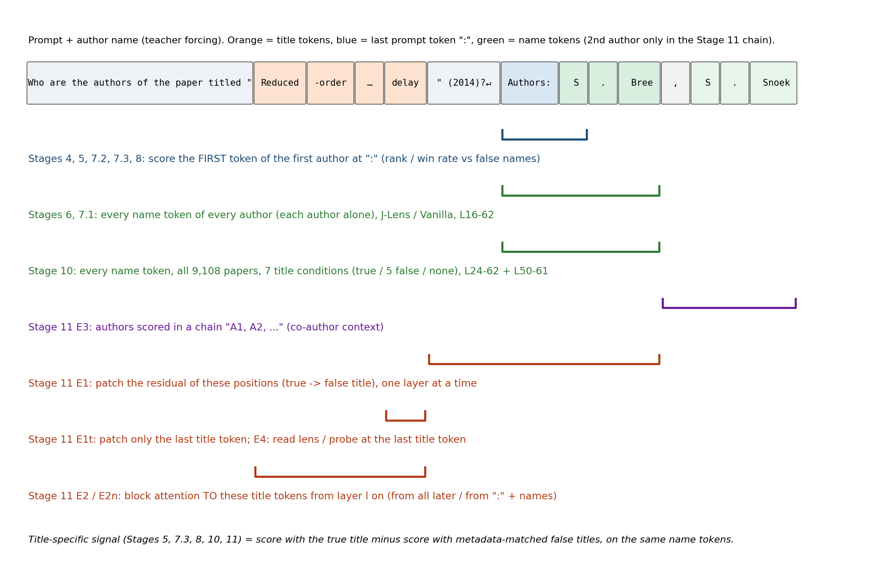

# README

## One-Page Summary

**Question: Can a paper's title raise the readout score of the correct author?**

- Model: Qwen3-32B. We compare J-Lens, Vanilla, and Final-model outputs.
- Readout: Look at the Gold Token rank first, then separate the first token of a name from the continuation after the correct prefix.
- Controls: Hold the author candidates fixed and compare the true title against matched wrong titles; finally, validate on new papers.

**Strongest result: On the 200 new Stage 8 papers, the mean Title Advantage at L56 is +5.18 percentage points; the mean A−B difference is +4.98 percentage points, but it is sensitive to a small number of strongly positive pairs.**

**Stage 10 (all 9,108 papers, every author name token):** the paper-specific (true-title minus matched-false-title) signal is about zero from L24 to L48, builds up from about L50, rises fastest over L57–L61, and peaks at L61–L63. Target papers (recognised but not recalled) pull ahead of control papers only there: +0.21 to +0.23 log10(1/rank) within citation bins at L62/L63, with no middle-layer head start under any lens.

This does not support claims of full author-identity recovery, causal Recall, or J-Lens outperforming Vanilla. For completeness and exclusions, see [ARCHIVE_NOTES.md](ARCHIVE_NOTES.md). This file references images in `docs/assets/`; the two must be kept together in the archive root.

## Stage Overview: Data, Method, Dates

| Stage | Question | Data size | Method | Readout, layers | Dates |
|---|---|---|---|---|---|
| Labels | Which papers does the model recall / recognise? | 9,108 papers (A/B/C/D = 6,841) | Open answer + 4-option multiple choice in 4 orders | Model output | label package 2026-10-15 |
| 4 | Is the mean pulled up by a few papers? | Benchmark20: 20 papers | First-listed author's first token at ":"; per-paper contribution | Public J-Lens, L16–62 | 2026-10-15 |
| 5 | Does the score depend on title–author correspondence? | Pilot50 (A20/B20/C7/D3), 20 A/B pairs | 2 titles × 2 authors crossed; gold vs false first token from the same logits | Public J-Lens, L16–62 | 2026-10-15 |
| 6 | Full-name readout trajectories by group | Pilot50, 227 paper-author instances | Every name token of every author, teacher forcing; JMRR | Public J-Lens + Vanilla, L16–62 (+ Final) | 2026-10-15 |
| 7.1 | First token vs continuation | Stage 6 rows (14,580), 20 pairs | CPU re-analysis of Stage 6 | as Stage 6 | 2026-10-15 |
| 7.2 | Gold vs many false names | Pilot50 × 100 real false names (50 matched + 50 random) | First-token Gold Win Rate | Public J-Lens + Vanilla, L16–62 | 2026-10-15 |
| 7.3 | Gold advantage after a wrong-title background | Pilot50 × 20 metadata-matched wrong titles | Title Advantage = true − mean wrong-title win rate | Public J-Lens + Vanilla, L16–62 | 2026-10-15 (score 2026-10-21) |
| 7.4 | Consistency across stages; J-Lens increment | same 50 papers | CPU correlations, J−V | — | 2026-10-15 |
| 8 | Does it hold on new papers? | 200 new papers, 100 A/B pairs (Low/Mid/High 25/50/25) | Frozen candidates and titles; L56 pre-specified; 8B controls, 8C scores, 8D analysis | Public J-Lens + Vanilla, L16–62 | 8A 2026-10-15, 8B–D 2026-10-20 |
| 9 | New lens fits (Fit A/B 100/100, Holdout100) | 200 fitting texts + 100 holdout | Jacobian lens fitting | — | 10-18 → 10-22, archived separately |
| **10** | **At which layer does the model hold a paper's authors? (full cohort)** | **9,108 papers, 33,811 authors, 149,999 name tokens** | **Every name token, each author alone; 7 title conditions (true, 5 matched false, none); target vs control (`group_tight`) within citation bins** | **Vanilla, public / Self100 / Fit A J-Lens, Final; L24–62 (+ L50–61 for public and Vanilla)** | **frozen 2026-10-23, GPU 10-24 → 10-26, analyses 10-26** |
| **11** | **Is the information formed late, or present at the title earlier and moved late?** | **1,186 papers (593 target / 593 control) for patching and knockout; 9,108 for title position and author chain** | **Activation patching (tail / last title token), attention knockout (all later / name positions), lens + ridge probe at the last title token, author chain** | **Final output; Vanilla + public J-Lens L16–62 at the title position** | **frozen 2026-10-26, GPU 2026-10-27, done 2026-10-27** |

Stage 4–8A dates are as given by the experiment lead (2026-10-15).

## Start Here

| Your task | Reading path |
|---|---|
| Understand the study | Summary → Concepts → Research thread → Stage 8 results |
| Check the evidence | Stage cards → corresponding Report/CSV → Config/Raw |
| Take over the runs | Directory map → CPU exercise → ARCHIVE_NOTES and the actual CLI |

## Concepts at a Glance

- **J-Lens (Jacobian Lens)**: This project uses a Jacobian mapping estimated from generic text to read the internal representation at a given source layer toward the target-layer representation space, then applies the output readout to obtain vocabulary scores. The input is the model's intermediate representation; the output is Token scores/ranks, not a label for "whether the knowledge exists." The exact normalization and mapping operation are defined by the implementation and configuration used in this package.
- **Vanilla**: No Jacobian mapping; the intermediate representation is converted to Token scores directly through the baseline readout path.
- **Layers**: L16/24/32/40/48/56/62 are the source layers; L63 is the Final layer, listed separately as the Reference, and the seven-layer Integrated score does not include it.
- **Gold / False**: The true author candidate / a wrong author candidate. In the later stages the comparison is mainly on the first token of the first author.
- **Wrong-title / Shuffled**: Pre-selected, metadata-matched replacement titles (the "Shuffled" in the reports is this kind of control) [TO VERIFY: the statement "not a word-level shuffle"]; not a naturally exchangeable randomization sample.
- **Recognition**: The behavioral result of identifying the author team from the options. **R0** means m=0, no matched author; **R1** means m>0, a partial match.

| Behavior group | Recognition | Recall | Current cohort N |
|---|---|---|---:|
| A | Pass | R0 | 4110 |
| B | Fail | R0 | 2186 |
| C | Pass | R1 | 511 |
| D | Fail | R1 | 34 |

**Shared settings:** Qwen3-32B BF16; model revision `9216db5781bf21249d130ec9da846c4624c16137`; source layers L16/24/32/40/48/56/62. For specific parameters, use each Stage's frozen config.

**Samples:** 6,841 papers in total; the source labels cover 9,108 papers. Pilot50 = A20/B20/C7/D3 (20 A/B pairs); Stage 8 = 200 new papers (Pilot50 excluded), 100 A/B pairs, with Low/Middle/High being 25/50/25 pairs. HR2 follows the definition in the label package and must not be interpreted by yourself as author Recall Accuracy. The current work did not create a new Build/Tune/Test split; the earlier matched splits belong to the historical plan.

**Three different A/B labelings — do not mix them: behavior A/B is the Recognition grouping; historical Lens A/B is the 50/50 fitting texts; Stage 9 Fit A/B is the new 100/100 fitting texts.**

**Stage 10–11 use the label package's `group_tight` instead of A/B/C/D:** target = cannot write the authors (R0/R1) but picks the true list in 4 of 4 orders with mean true-option probability ≥ 0.5 (4,621 papers); control = R0/R1 and at most 1 of 4 (2,220); guard = R2 (214); excluded = the rest (2,053). Target/control therefore pool R0 and R1 and use the tightened pass rule; they are not the same papers as behavior A/B.

| Metric | How it is computed / what it measures |
|---|---|
| RR | 1 / the Gold Token's rank in the full vocabulary |
| Full-name JMRR | Average over tokens within an author, then over authors within a paper; later tokens are given the correct prefix |
| Gold Win Rate | Gold first token beats a False record = 1, tie = .5, loss = 0, then averaged |
| Title Advantage | True-title Win Rate − mean of the 20 Wrong-title Win Rates |
| A−B | Effect difference within a matched paper pair |
| J−V | J-Lens effect minus Vanilla effect on the same paper under the same conditions |
| log10(1/rank) (Stage 10–11) | Per name token: 0 = rank 1, −1 = rank 10, minimum −5.18; averaged over a paper's tokens, then over papers |
| Title-specific signal (Stage 10–11) | Per paper: true-title score − mean over 5 metadata-matched false titles (same tokens, so name guessability cancels) |
| Target − control (Stage 10–11) | Difference pooled within citation bins (bins with ≥ 30 papers in both groups), weights n_t·n_c/(n_t+n_c) |

## Research Thread

**Where does the score come from?** Stage 4 → Stage 6 → Stage 7.1.  
**Does it depend on the correct title?** Stage 5 → Stage 7.2 → Stage 7.3.  
**Is it consistent, and does it generalize?** Stage 7.4 → Stage 8.  
**At which layer is the paper's author information formed, on the full cohort?** Stage 10 → Stage 11.  
Fidelity, provenance audit, and the historical Split-half run through all three lines.

### Stage 4 · Is the mean pulled up by a few papers?
- Approach: Benchmark20; examine the distribution across papers and each paper's contribution.
- Key numbers: L56 first-listed first-token RR mean .007040 (median .000920); a single paper contributes 71.03%.
- Judgment: The mean alone does not show broad accessibility; move on to author coverage and name position.

### Stage 5 · Does the score depend on the title–author correspondence?
- Approach: Two titles × two authors, crossed; Q's author and Q's title must come from the same source.
- Key numbers: L56 pooled logit contrast +1.16679; the Integrated A−B interval crosses zero.
- Judgment: Title sensitivity exists, but a single False/Title reference is still too narrow.

### Stage 6 → 7.1 · Does the advantage arise before the name starts, or after a prefix is given?
- Approach: 50 papers, 227 paper-author instances; reuse the per-token scores and split them into First / Continuation.
- Key numbers: A−B: First +.00137 (CI crosses zero); Continuation +.02064 (nominal CI is positive). [TO VERIFY: the archived report does not state the layer or aggregation; check whether this is Integrated]
- Judgment: The difference is concentrated in conditional continuation; the role of the prefix is not causally isolated.

### Stage 7.2 → 7.3 · Does the Gold advantage remain after subtracting the wrong-title background?
- Approach: 100 False names per paper; fixed candidates, plus 20 Wrong titles per paper.
- Key numbers: the 100 names average 45.76 distinct first tokens; Pilot50 L56 Title Advantage +.093435.
- Judgment: The pooled title effect is retained, while the Integrated A−B remains uncertain; a candidate's first token is not a full identity.

### Stage 7.4 · Are the methods consistent, and does J-Lens provide additional information?
- Approach: Cross-stage correlation on the same 50 papers, and a same-paper J−V comparison.
- Key numbers: L56 Pearson .445; Integrated J−V +.00221, CI crosses zero.
- Judgment: Moderate measurement consistency; independent replication and a J-Lens increment are not established.

### Stage 8 · Does the signal hold on new papers?
- Approach: Exclude Pilot50; freeze 200 papers / 100 pairs, the candidates, and the titles; L56 is the pre-specified primary layer.
- Key numbers: RQ1 +5.18 pp; RQ2 +4.98 pp.
- Judgment: The new targets retain the mean title effect; read the group difference together with the influence analysis.

### Stage 10 · Layer-wise readout of every author name, all 9,108 papers
- Approach: each author scored alone after "Authors:", every name token (33,811 authors, 149,999 tokens) under teacher forcing; readouts Vanilla (logit lens), three J-Lenses (public, Self100, Fit A) and Final at L24/32/40/48/56/62 (+ L50–55, L57–61 for public and Vanilla); 7 title conditions (true, 5 matched false titles, title deleted); groups from `group_tight`.
- Key numbers: title-specific signal ≤ 0.05 at L24–L48 in both groups; target − control (title-specific, within bin) Vanilla +0.007 [0.001, 0.014] at L50, +0.065 at L56, +0.229 at L62, Final +0.207 [0.196, 0.220]; the signal sits on the surname for initial-first names and equally on given name and surname for given-name-first names; it rises monotonically with citations (Spearman ρ = 0.45). J-Lenses read more name information than Vanilla in middle layers (+0.007 to +0.030 title-specific) but it is not larger for target papers.
- Judgment: paper-specific author knowledge is assembled late and gradually; recognised-but-not-recalled papers have no middle-layer head start. Correlational only. The parity tolerance was raised from 0.25 to 0.5 max |Δlogit| after seeing bf16-level differences (recorded in `config/analysis_plan.json`).

### Stage 11 · Causal and context follow-ups (completed 2026-10-27)
- Approach: on 593 target + 593 control papers balanced within citation bins: E1 activation patching (true → false-title residual at the tokens after the title, one layer at a time), E2 attention knockout of the title tokens from layer l on; on all papers: E3 author-chain scoring ("Authors: A1, A2, …", paired with the Stage 10 isolated scores). Amendment 1 (2026-10-27) asks whether the author is already present at the TITLE position before ~L56 and only moved to the name positions later (subject enrichment → attribute extraction): E1t patches only the last title token, E2n blocks only the name positions from the title, E4 reads the logit / public J-Lens and a ridge probe at the last title token (all 9,108 papers, true vs 5 false titles).
- Key numbers (share of the true − false-title gap at the output):
  - Patching the tokens after the title: 0.08 at L24, 0.29 at L40, 0.83 at L48, 1.00 from L52.
  - Patching only the last title token: about 0.12, and 0 from L56.
  - Blocking attention to the title from layer l: loss 0.83 (L0), 0.37 (L32), 0.14 (L40), 0.06 (L48), 0 from L52.
  - Blocking only ":" and the names: ≤ 0.15.
  - At the last title token: lenses about 0.01–0.03; ridge probe +0.04 to +0.08, target − control +0.02 to +0.04.
  - Author chain: later authors +0.17 to +0.23 easier, while their title-specific signal shrinks.
- Judgment: the paper information is read from the title and moved into the post-title tokens in L24–L50, about ten layers before it is lens-readable at the names. It does not sit on the title token in a lens-readable form. Target and control share the timing; target carries about 2× the signal. The GPU smoke WARN (batched bf16 rounding) does not affect this.

## Directory Map: Where to Find the Evidence

For completeness and exclusions, see [ARCHIVE_NOTES.md](ARCHIVE_NOTES.md). In the table below, all outputs are relative to `experiment_files/` and source code is relative to `code/scratch_scripts/`.

| Content | Source code | Output entry point |
|---|---|---|
| Cohort | 351_prepare_all.py | 351_all/; labels_20261015/ |
| Stage 4 | 351_stage4_readout.py; 351_stage4_audit.py | 351_all/351_stage4_artifacts/ |
| Stage 5 | 351_stage5.py | 351_stage5_crossed_v2/ |
| Stage 6 | 351_stage6.py | 351_stage6/ |
| Stage 7.1 | 351_stage7.py | 351_stage7_1/ |
| Stage 7.2/7.3 | 351_stage7_2.py / 351_stage7_3.py and the respective _score.py | 351_stage7_2/; 351_stage7_3/ |
| Stage 7.4 | 351_stage7_4.py | 351_stage7_4/ |
| Stage 8A–D | 351_stage8.py, 351_stage8B/C/D.py | 351_stage8/; 8D is under its stage8D/ |
| Stage 10 | 351_stage10.py (frozen) run through 351_stage10_fix1.py; stage10_extra*.py for §6.7–6.9 | 351_stage10/ (raw/ not included) |
| Stage 11 | 361_stage11.py; stage11_analyze.py; stage11_keeper.py | 361_stage11/ (raw/ not included) |

Read each experiment in the order **config → cohort/matching/controls → raw → summary → figures/reports**; not every stage contains all of these subdirectories.

## Status

| Status | Content |
|---|---|
| Executed, outputs exist, archived | Stage 4–8D; cohort, historical fitting/validation, and Split-half materials |
| Execution identity must be verified run by run | Whether the currently collected source matches the historical executed version character for character; some historical environments/parameters |
| Not executed | Stage 8E; draft numbers are not treated as verified evidence |
| Executed, archived without raw per-token files | Stage 10 (config, cohort, summaries, figures, reports, talk deck; raw/ is 1.2 GB and regenerable) |
| Executed, archived without raw files | Stage 11 (config, summary CSVs, report; raw/ excluded) |
| Excluded from this package, archived separately | Stage 7.1B, Stage 9 (still running at archive time) |
