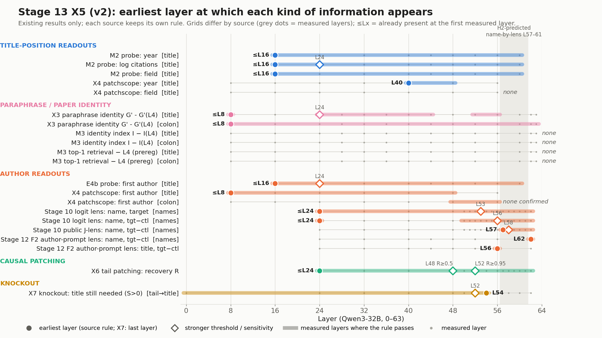

# Stage 13 X5: layer order (existing results only), version 2

Version 2 (2026-11-05): adds the pre-registered "paper identity retrievable across tasks" row (M3 cache, cross-task top-1 retrieval, V56; details `reports/x5_retrieval.md`). v1 files (`x5_report.md`, `x5_layer_order.png/.svg/.csv`) are unchanged.
Script `~/jlens_work/13_stage13/stage13_x5_layer_order_v2.py`, run 2026-11-05 01:42. CPU only; no model runs.
Definition: prereg.json X5 ("for each layer: paper identity retrievable across tasks (M3, top-1 retrieval among the test papers), first-author token by probe (M2/E4b), name by lens (Stage 10)"); rules per source as in prereg.json and addenda 1-5.
Each source keeps its own rule: first layer whose interval excludes 0 (or above the null / the pre-registered threshold). Grids differ by source; "<= Lx" means the first measured layer already passes.
Table: `summary_x5/x5_layer_order_v2.csv` (with rule, note and source file per row). Figure: `reports/x5_layer_order_v2.png` / `.svg`.

| kind | measure | position | grid (layers) | earliest (rule) | stronger threshold | passes at every later layer from | value at earliest [95% CI] |
|---|---|---|---|---|---|---|---|
| Title-position readouts | M2 probe: year (R2) | last title token | 16,24,32,40,44,48,52,56,60 | <= L16 | <= L16 (Qwen - best BERT layer >= 0.10; BERT best 0.240; reference only, addendum 2) | L16 | +0.383 [+0.362, +0.403] (team) |
| Title-position readouts | M2 probe: log citations (R2) | last title token | 16,24,32,40,44,48,52,56,60 | <= L16 | L24 (Qwen - best BERT layer >= 0.10; BERT best 0.188; reference only, addendum 2) | L16 | +0.286 [+0.269, +0.302] (team) |
| Title-position readouts | M2 probe: field (accuracy) | last title token | 16,24,32,40,44,48,52,56,60 | <= L16 | n/a | L16 | +0.698 [+0.688, +0.708] (team) |
| Title-position readouts | X4 patchscope: year | title (last token) | 8,16,24,32,40,48,56 | L40 | n/a | - | +0.013 [+0.008, +0.018] (team, test) |
| Title-position readouts | X4 patchscope: field | title (last token) | 8,16,24,32,40,48,56 | none on tune | n/a | - | - |
| Paraphrase / paper identity | X3 paraphrase identity G' - G'(L4) | last title token | 8,16,24,28,32,36,40,44,48,52,56,60,62,63 | <= L8 (confirmed) | sensitivity set (addendum 5): L24 -> not robust | - | +0.012 [+0.004, +0.019] (team, test) |
| Paraphrase / paper identity | X3 paraphrase identity G' - G'(L4) | colon | 8,16,24,28,32,36,40,44,48,52,56,60,62,63 | <= L8 (confirmed) | sensitivity set (addendum 5): L8 | L8 | +0.001 [+0.000, +0.001] (team, test) |
| Paraphrase / paper identity | M3 identity index I - I(L4) (never above L4) | last title token | 8,16,24,28,32,36,40,44,48,52,56,60,62,63 | none | n/a | - | - |
| Paraphrase / paper identity | M3 identity index I - I(L4) (never above L4) | colon | 8,16,24,28,32,36,40,44,48,52,56,60,62,63 | none | n/a | - | - |
| Paraphrase / paper identity | M3 top-1 cross-task retrieval - L4 (prereg X5 curve) | last title token | 8,16,24,28,32,36,40,44,48,52,56,60,62,63 | none on tune | n/a | - | - |
| Paraphrase / paper identity | M3 top-1 cross-task retrieval - L4 (prereg X5 curve) | colon | 8,16,24,28,32,36,40,44,48,52,56,60,62,63 | none on tune | n/a | - | - |
| Author readouts | E4b probe: first-author token, title-specific | title position | 16,24,32,40,44,48,52,56,60 | <= L16 | L24: target - control within bin > 0, +0.052 [+0.017, +0.089] | L16 | +0.041 [+0.028, +0.054] (paper bootstrap) |
| Author readouts | X4 patchscope: first author | title (last token) | 8,16,24,32,40,48,56 | <= L8 | n/a | - | +0.046 [+0.035, +0.059] (team, test) |
| Author readouts | X4 patchscope: first author | colon | 8,16,24,32,40,48,56 | L24 on tune, NOT confirmed on test | n/a | L48 | - |
| Author readouts | Stage 10 logit lens: name, target papers | author-name tokens | 24,32,40,48,50,51,52,53,54,55,56,57,58,59,60,61,62 | <= L24 | L53 (estimate >= 0.05, the Stage 10 'about 0' bound) | L24 | +0.004 [+0.002, +0.006] (team) |
| Author readouts | Stage 10 logit lens: name, target - control | author-name tokens | 24,32,40,48,50,51,52,53,54,55,56,57,58,59,60,61,62 | <= L24 | L56 (estimate >= 0.05, the Stage 10 'about 0' bound) | L50 | +0.007 [+0.003, +0.011] (team) |
| Author readouts | Stage 10 public J-lens: name, target - control | author-name tokens | 24,32,40,48,50,51,52,53,54,55,56,57,58,59,60,61,62 | L57 | L58 (estimate >= 0.05, the Stage 10 'about 0' bound) | L57 | +0.029 [+0.007, +0.052] (team) |
| Author readouts | Stage 12 F2 author-prompt lens: name, target - control | author-name tokens | 24,32,40,44,48,52,56,62 | L62 | n/a | L62 | +0.238 [+0.210, +0.267] (Stage 12 bootstrap) |
| Author readouts | Stage 12 F2 author-prompt lens: title, target - control | title position | 24,32,40,44,48,52,56,62 | L56 | n/a | - | +0.030 [+0.000, +0.060] (Stage 12 bootstrap) |
| Causal patching | X6 tail patching: recovery R (avg 5 false titles) | post-title tail | 24,32,40,48,50,52,54,56,57,58,59,60,61,62 | <= L24 | L48 (R >= 0.5, 0.821); L52 (R >= 0.95, 0.995) | L24 | +0.080 [+0.075, +0.086] (team) |
| Knockout | X7 knockout: paper-specific loss S(l), block title from l | post-title tail -> title | 0,24,32,40,48,50,52,54,56,58,60,62 | L54 (last with S > 0) | L52 (first S <= 0.05, +0.029) | - | +0.006 [+0.001, +0.012] (team) |

## Notes per row

- **M2 probe: year (R2)** [last title token]: rule = first layer with team-cluster CI above 0. grid starts at L16; title-text BERT baseline (M2c) shown as reference only. Source `/scratch/zhang.zhiqi2/jlens/381_stage13/summary_cpu_teamci/M2_teamci.csv`.
- **M2 probe: log citations (R2)** [last title token]: rule = first layer with team-cluster CI above 0. grid starts at L16; title-text BERT baseline (M2c) shown as reference only. Source `/scratch/zhang.zhiqi2/jlens/381_stage13/summary_cpu_teamci/M2_teamci.csv`.
- **M2 probe: field (accuracy)** [last title token]: rule = first layer with team-cluster CI above the shuffled-label null (0.135). grid starts at L16; title-text BERT baseline (M2c) shown as reference only. Source `/scratch/zhang.zhiqi2/jlens/381_stage13/summary_cpu_teamci/M2_teamci.csv`.
- **X4 patchscope: year** [title (last token)]: rule = first layer with D CI > 0 on tune, confirmed on test (prereg X4). chosen on tune, confirmed on test; bar = layers with CI > 0 on both tune and test. Source `/scratch/zhang.zhiqi2/jlens/381_stage13/summary_x1x4/x4_earliest.csv`.
- **X4 patchscope: field** [title (last token)]: rule = first layer with D CI > 0 on tune, confirmed on test (prereg X4). no layer with D's CI above 0 on tune; bar = layers with CI > 0 on both tune and test. Source `/scratch/zhang.zhiqi2/jlens/381_stage13/summary_x1x4/x4_earliest.csv`.
- **X3 paraphrase identity G' - G'(L4)** [last title token]: rule = first layer with G' > 0 and G' - G'(L4) > 0 (team CI) on tune, confirmed on test (addendum 4). L4 is the reference, first testable layer L8; cannot separate meaning from paper identity; bar = tune and test both pass. Source `/scratch/zhang.zhiqi2/jlens/381_stage13/summary_x3/x3_identity_verdict.csv`.
- **X3 paraphrase identity G' - G'(L4)** [colon]: rule = first layer with G' > 0 and G' - G'(L4) > 0 (team CI) on tune, confirmed on test (addendum 4). L4 is the reference, first testable layer L8; cannot separate meaning from paper identity; bar = tune and test both pass. Source `/scratch/zhang.zhiqi2/jlens/381_stage13/summary_x3/x3_identity_verdict.csv`.
- **M3 identity index I - I(L4) (never above L4)** [last title token]: rule = first layer with I(l) - I(L4) CI above 0 (addendum 2); top-1 retrieval: see the V56 row. never above L4 (max I - I(L4) = -0.003 at L16); M3 does not support H2. Source `/scratch/zhang.zhiqi2/jlens/381_stage13/summary_m3/m3_verdict_addendum2.csv`.
- **M3 identity index I - I(L4) (never above L4)** [colon]: rule = first layer with I(l) - I(L4) CI above 0 (addendum 2); top-1 retrieval: see the V56 row. never above L4 (max I - I(L4) = -0.041 at L8); M3 does not support H2. Source `/scratch/zhang.zhiqi2/jlens/381_stage13/summary_m3/m3_verdict_addendum2.csv`.
- **M3 top-1 cross-task retrieval - L4 (prereg X5 curve)** [last title token]: rule = first layer with retrieval(l) - retrieval(L4) team CI > 0 on tune, confirmed on test (addendum 2 logic). all 9,108 papers: top-1 at L4 1.0000 (chance 0.00011); lowest 0.7337 at L63; retrieval is at or near ceiling at L4 from the identical title tokens, so it cannot rise above L4. Source `/scratch/zhang.zhiqi2/jlens/381_stage13/summary_x5/x5_retrieval_earliest.csv`.
- **M3 top-1 cross-task retrieval - L4 (prereg X5 curve)** [colon]: rule = first layer with retrieval(l) - retrieval(L4) team CI > 0 on tune, confirmed on test (addendum 2 logic). all 9,108 papers: top-1 at L4 0.9996 (chance 0.00011); lowest 0.1132 at L44; retrieval is at or near ceiling at L4 from the identical title tokens, so it cannot rise above L4. Source `/scratch/zhang.zhiqi2/jlens/381_stage13/summary_x5/x5_retrieval_earliest.csv`.
- **E4b probe: first-author token, title-specific** [title position]: rule = first layer with all-paper title-specific signal CI > 0 (confirmatory: team folds + title-reuse dropped). grid starts at L16. Source `/scratch/zhang.zhiqi2/jlens/381_stage13/summary_cpu_trainstd/compare_E4b_allpapers.csv`.
- **X4 patchscope: first author** [title (last token)]: rule = first layer with D CI > 0 on tune, confirmed on test (prereg X4). chosen on tune, confirmed on test; bar = layers with CI > 0 on both tune and test. Source `/scratch/zhang.zhiqi2/jlens/381_stage13/summary_x1x4/x4_earliest.csv`.
- **X4 patchscope: first author** [colon]: rule = first layer with D CI > 0 on tune, confirmed on test (prereg X4). tune L24; test D +0.001 [-0.000, +0.003]; bar = layers with CI > 0 on both tune and test. Source `/scratch/zhang.zhiqi2/jlens/381_stage13/summary_x1x4/x4_earliest.csv`.
- **Stage 10 logit lens: name, target papers** [author-name tokens]: rule = first layer with title-specific log10(1/rank) team CI > 0. prereg H2 placed name-by-lens at L57-61; grid L24,32,40,48,50-62. Source `/scratch/zhang.zhiqi2/jlens/381_stage13/summary_cpu_group/cluster_ci_all.csv`.
- **Stage 10 logit lens: name, target - control** [author-name tokens]: rule = first layer with title-specific log10(1/rank) team CI > 0. prereg H2 placed name-by-lens at L57-61; grid L24,32,40,48,50-62. Source `/scratch/zhang.zhiqi2/jlens/381_stage13/summary_cpu_group/cluster_ci_all.csv`.
- **Stage 10 public J-lens: name, target - control** [author-name tokens]: rule = first layer with title-specific log10(1/rank) team CI > 0. prereg H2 placed name-by-lens at L57-61; grid L24,32,40,48,50-62. Source `/scratch/zhang.zhiqi2/jlens/381_stage13/summary_cpu_group/cluster_ci_all.csv`.
- **Stage 12 F2 author-prompt lens: name, target - control** [author-name tokens]: rule = first layer with target - control CI > 0. negative at L32, L44-52. Source `/scratch/zhang.zhiqi2/jlens/371_stage12/summary/F2_author_lens.csv`.
- **Stage 12 F2 author-prompt lens: title, target - control** [title position]: rule = first layer with target - control CI > 0. only L56 passes (lower bound +0.0004). Source `/scratch/zhang.zhiqi2/jlens/371_stage12/summary/F2_author_lens.csv`.
- **X6 tail patching: recovery R (avg 5 false titles)** [post-title tail]: rule = first layer with R team CI > 0. target / control: R>=0.5 at L48 / L48, R>=0.95 at L52 / L50; grid starts at L24; L63 (=1 by construction) left out. Source `/scratch/zhang.zhiqi2/jlens/381_stage13/summary_x6/x6_recovery.csv`.
- **X7 knockout: paper-specific loss S(l), block title from l** [post-title tail -> title]: rule = LAST block-from layer with S team CI > 0 (title still needed up to here). target / control: last S > 0 at L52 / L54, S <= 0.05 from L52 / L54. Source `/scratch/zhang.zhiqi2/jlens/381_stage13/summary_x7/x7_knockout.csv`.

## Summary of the order

- At the last title token, year, log citations and field are probe-decodable at the first measured layer (<= L16, M2), and the first-author token is decodable by patchscope at <= L8 (X4) and by probe at <= L16 (E4b); the patchscope year appears at L40 and the patchscope field is never confirmed.
- Paraphrase identity (X3 G' - G'(L4)) appears at <= L8 in the primary set but at L24 in the sensitivity set (not robust). The M3 identity index never rises above its L4 level, and the pre-registered cross-task top-1 retrieval (V56) is title_last: top-1 at L4 1.000, range 0.734-1.000, earliest above L4: none; colon: top-1 at L4 1.000, range 0.113-1.000, earliest above L4: none; so M3 gives no identity layer.
- Causally, patching the post-title tail recovers > 0 from <= L24, half the gap by L48 and >= 0.95 by L52 (X6); blocking the title stops costing paper-specific signal from L52 (S <= 0.05), with the last significant loss at L54 (X7).
- At the name positions the lens signal passes the CI rule already at L24 but stays tiny (< 0.01) until L50; it exceeds 0.05 at L53 (logit, target) and target - control exceeds 0.05 at L56 (logit) / L58 (public J-lens); the author-prompt lens (F2) shows target - control > 0 only at L62.
- Order (by the stronger thresholds): title-position facts and author token (<= L8-L16) -> tail carries the paper signal (L48-L52) -> name-position lens readout (L53-L62).

## Caveats

- M3 does not support H2: neither the transfer ratio, the identity index nor the cross-task top-1 retrieval is above the L4 text level at the title; X5's "identity first" leg therefore has no M3 layer. Retrieval at the title is at ceiling already at L4 (identical title tokens), so "above L4" is impossible for it there; this is a limit of the measure, not evidence against identity.
- X3 cannot separate meaning from paper identity (a paraphrase keeps the meaning); its <= L8 onset is not robust (sensitivity set: L24).
- The X4 L8 first-author signal at the title may be explainable by the title text (see x4_textbase reports); X4 colon author is not confirmed on test.
- The strict "CI excludes 0" rule gives very early but tiny effects for the Stage 10 lens (L24, about 0.004-0.007); the stronger 0.05 bound is the Stage 10 "about 0" convention, not a pre-registered threshold. M2 vs BERT is a reference only (addendum 2).
- Intervals: team-cluster for M2, X3, X4, M3, Stage 10 (cluster_ci_all), X6, X7; E4b all-paper is a paper bootstrap; F2 is the Stage 12 bootstrap.
- This summary adds no conclusion beyond the ordering.
